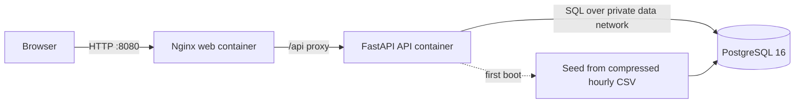

# EcoMetrics Campus Dashboard

EcoMetrics is a containerized campus-energy dashboard built as an original capstone project for Linux and Container Technologies. It turns public, historical building-meter readings into a small operations view: campus electricity, floor-area intensity, academic-calendar patterns, and meter-data trust.

The application uses I-BLEND, a public IIIT-Delhi building-energy dataset. It is a historical case study from 2013–2017, not a live feed or a claim about another campus. The three core functions are the campus energy overview, building intensity comparison, and operating-profile analysis. A fourth feature, **Meter Trust**, makes missingness, partial hours, and statistical outliers visible alongside the energy numbers.

The interface, ETL pipeline, API, container configuration, and explanations in this repository were created for this project. The previous-batch report and sample presentation were reference material only; their content and dashboard layout were not reused.

## Start the dashboard

Prerequisites: Docker Engine with Docker Compose v2, or Docker Desktop with its container engine running.

1. Copy `.env.example` to `.env` and replace `POSTGRES_PASSWORD` with a long local password.
2. From this project folder, run:

   ```sh
   docker compose up --build -d
   ```

3. Open [http://localhost:8080](http://localhost:8080).
4. View service state and logs:

   ```sh
   docker compose ps
   docker compose logs -f api
   ```

### Run the published images

When the images are published to GHCR, a recipient does not need the source code or a local build. Share `compose.published.yaml` and `.env.published.example`; the recipient sets `GHCR_OWNER` and a local database password in `.env`, then runs:

```sh
docker compose -f compose.published.yaml up -d --pull always
```

Open [http://localhost:8080](http://localhost:8080). See [docs/PUBLISHING.md](docs/PUBLISHING.md) for the publishing, public package, and image-upgrade steps. A public hosted URL needs a configured hosting cluster; published images by themselves are not an always-on deployment.

On this Windows Docker Desktop installation, the default BuildKit storage was damaged and needed a WSL restart. I created a separate builder named `ecometrics-recovery`. If a future build again reports a read-only filesystem or corrupted shared library, use:

```sh
docker compose --env-file .env build --builder ecometrics-recovery
docker compose --env-file .env up --detach --no-build
```

The normal `docker compose up --build -d` command remains the standard path on other Docker installations.

On first start, the API creates the PostgreSQL schema and loads the included hourly CSV once. The database is kept in the named `postgres-data` volume. `docker compose down` stops the services and keeps the volume. `docker compose down -v` also deletes the database volume and its contents.

The original minute-level archive is about 562 MB and is not needed to run the dashboard. A compact, transformed dataset is included at `data/energy_hourly.csv.gz`. See [data/README.md](data/README.md) for its source, license, transformation, and reproducibility steps.

## What the dashboard does

1. **Campus energy monitoring** — date and building filters, recorded-energy trend, and prior-period comparison.
2. **Building performance** — ranked use, floor-area intensity, average meter coverage, and a grid-CO₂ scenario estimate.
3. **Operating profile** — mean load by local hour, working/non-working and high/low academic-activity comparisons, and building night-to-day review signals.
4. **Meter Trust (new functionality)** — expected-hour coverage, usable/partial/missing readings, statistical spikes to review, a building coverage view, and CSV export of all flagged intervals for the selected window.

The first two functions are presented together on the overview page. The project has three core functional areas plus Meter Trust as the additional gap-focused feature.

## Architecture



Docker Compose has three services: `web`, `api`, and `db`. Only Nginx publishes a host port. The database is on an internal network; Nginx proxies API calls to the backend. PostgreSQL persists to a named volume. The API imports the compact CSV during first initialization using PostgreSQL `COPY`.

The root [Dockerfile](Dockerfile) builds a Python virtual environment in a dependency stage and copies it into a smaller runtime stage. Both application containers run without root and with a read-only root filesystem in Compose. Compose also configures health checks, resource limits, a private data network, dropped Linux capabilities, and `no-new-privileges`.

See [docs/ARCHITECTURE.md](docs/ARCHITECTURE.md) for the container, deployment, and data-flow details.

## Continuous build, upgrade, and deployment

- `.github/workflows/ci.yml` validates the Compose model and builds both images for pull requests and pushes to `main`.
- `.github/workflows/publish.yml` builds and publishes versioned API and web images to GitHub Container Registry (GHCR) for `main` and semantic-version tags such as `v1.0.0`. BuildKit layer caches are enabled.
- `.github/dependabot.yml` checks Python packages, Docker base images, and GitHub Actions weekly.
- `.github/workflows/deploy-openshift.yml` provides an explicit, manually triggered rollout to OpenShift after images have been published.

The deployment path is intentionally promote-by-tag: CI builds the same image artifact that the cluster deploys, while the OpenShift rollout remains an operator-triggered step. Follow [docs/PUBLISHING.md](docs/PUBLISHING.md) to publish images and run them without a source checkout; follow [docs/DEPLOYMENT.md](docs/DEPLOYMENT.md) to configure OpenShift credentials, the database secret, and the first hosted deployment.

## Course-outcome mapping

| Course outcome | Project evidence |
| --- | --- |
| Linux operations | Linux-based container images, file permissions, process identity, logs, health checks, networks, and persistent volumes; commands in the viva guide. |
| Podman architecture and functionality | Viva guide explains daemonless/rootless Podman, OCI images, container inspection, and commands to build and run the images. |
| Dockerfiles, images, and registries | Multi-stage Dockerfiles, Compose builds, BuildKit caching, GHCR publishing, and immutable commit-SHA tags. |
| Running, networking, and troubleshooting containers | Three-service Compose topology, private networking, health checks, logs, `exec`, inspect, and recovery steps. |
| OpenShift/Kubernetes deployment | Deployments, Services, PVC, probes, resource limits, restricted security contexts, TLS Route, and a manual rollout workflow. |

The separate [viva guide](docs/VIVA_GUIDE.md) gives a suggested demonstration and short answers for the core concepts.

## Metrics and interpretation

- One-minute source readings are localized to `Asia/Kolkata`, then grouped into hourly building records.
- The hourly energy estimate is the mean measured power in kW over that hour multiplied by one hour. Hours below 75% minute coverage are excluded from energy totals; they remain visible in Meter Trust.
- `kWh/m²` uses floor areas reported for the source buildings and is a descriptive within-campus comparison. Building purpose, occupancy, and operating schedule differ.
- The grid-CO₂ number uses the Central Electricity Authority's weighted-average grid factor of `0.675 kg CO₂/kWh` for FY 2025–26. This current factor is applied to historic 2013–2017 energy as an illustrative scenario; it is not historical measured emissions and is not labeled CO₂e.
- Recorded-energy totals use available, usable building-hour readings; they can understate actual use where a meter is missing. The dashboard surfaces coverage and never fills missing values with zero.
- The night-to-day ratio is a review signal, not a savings estimate. A dormitory, server room, or other always-on load can be expected to run overnight.
- Outliers are statistical review flags, not confirmed faults. They use a robust within-building historical comparison and require a minimum number of peer observations.

## Rebuild the compact dataset

The included CSV is ready to use. To reproduce it, download the CC0 energy and calendar archives from the links in [data/README.md](data/README.md), then run:

```sh
python -m pip install pandas
python scripts/prepare_dataset.py --energy-archive energy_dataset.zip --calendar-archive iiitd_calender_schedule.zip
```

This ETL scans the large archive in chunks. It writes only the transformed hourly CSV and its profile into `data/`; it does not include or copy the source archive into Docker images.

## Repository map

```text
backend/                 FastAPI API, PostgreSQL schema and seed loader
data/                    Compact CC0-derived dataset and source notes
docs/                    Architecture, deployment, and viva materials
frontend/                Original responsive HTML/CSS/JavaScript dashboard and Nginx config
openshift/               OpenShift/Kubernetes resources
scripts/                 Reproducible CSV transformation
.github/workflows/       Build, publish, and manual deployment workflows
Dockerfile               Multi-stage API image
compose.yaml             Local three-service deployment
```

## Sources

- Dataset paper: [I-BLEND: a campus-scale building energy dataset from IIIT-Delhi](https://www.nature.com/articles/sdata201915).
- Source energy file and CC0 metadata: [Figshare energy archive, DOI 10.6084/m9.figshare.6007637.v1](https://doi.org/10.6084/m9.figshare.6007637.v1).
- Institute calendar file: [Figshare calendar archive](https://doi.org/10.6084/m9.figshare.6007634.v1).
- Emissions factor: [Central Electricity Authority CO₂ Baseline Database](https://cea.nic.in/cdm-co2-baseline-view?lang=en&mappingId=234), User Guide v22.0, FY 2025–26.
- OpenShift image deployment concepts: [Red Hat OpenShift 4.19 image documentation](https://docs.redhat.com/en/documentation/openshift_container_platform/4.19/html/images/overview-of-images).
- OpenShift-compatible PostgreSQL image: [SCLorg PostgreSQL container documentation](https://github.com/sclorg/postgresql-container).
