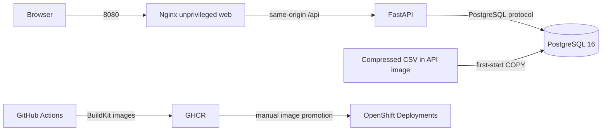

# Architecture and container design

## Runtime path



The local Compose model uses two Docker networks. `edge` carries inbound traffic to Nginx. `data` is marked internal and carries Nginx-to-API and API-to-database traffic. PostgreSQL does not publish a host port. Nginx forwards `/api/` to the API over the private network, so the browser sees a same-origin service and does not need database access.

## Startup and persistence

The API waits for PostgreSQL, creates tables and indexes if absent, loads the building reference, and copies the compressed CSV only when the readings table is empty. A PostgreSQL transaction-level advisory lock protects concurrent first starts. The Compose volume stores the database files across container recreation. The shipped CSV remains immutable application data; the database is the runtime query store.

If you replace the shipped CSV and build a new API image while keeping the existing database volume, run this operator reload inside the API container:

```sh
docker compose exec api python -m app.seed --replace
```

The operation truncates and reloads hourly rows, so it is an operator action rather than a routine container start.

## Docker image choices

- Root `Dockerfile`: Python 3.12 multi-stage build, venv copied from a dependency stage, slim runtime, bytecode disabled, no pip cache baked into the image, non-root UID, and an HTTP health check.
- `frontend/Dockerfile`: Nginx unprivileged image on port 8080, static assets copied into the image, and a lightweight health endpoint.
- BuildKit cache mount and GitHub Actions cache reduce repeat build work.
- Runtime Compose policies: read-only application root filesystems, writable temporary paths only, all Linux capabilities dropped, `no-new-privileges`, CPU/memory bounds, health checks, restart policies, and named PostgreSQL storage.
- The Compose file uses one locally configurable password and does not publish it into the frontend image or source control. Production should use the platform secret store.

## API surface

| Endpoint | Purpose |
| --- | --- |
| `/api/health/live` | Process liveness. |
| `/api/health/ready` | Database/data readiness. |
| `/api/filters` | Date range, building options, and local time zone. |
| `/api/overview` | Electricity, prior-period change, carbon scenario, and usable-hour totals. |
| `/api/trends` | Daily or monthly energy points. Null energy remains null when a bucket has no usable readings. |
| `/api/benchmarks` | Within-campus energy, floor-area intensity, and coverage by building. |
| `/api/activity` | Average campus load by hour and academic-calendar comparisons. |
| `/api/opportunities` | Day/night ratios as schedule-review signals. |
| `/api/quality` | Coverage, partial/missing hours, spike flags, and a sample of recent events. |
| `/api/quality/export.csv` | Stream all flagged rows in the selected date/building window. |

## Upgrade and deployment flow

Pull requests and pushes to `main` validate `compose.yaml` and build the API and web images. A separate workflow publishes `main`, semantic-version, and commit-SHA image tags to GHCR. Weekly Dependabot updates maintain Python dependencies, base images, and GitHub Actions. A manually dispatched OpenShift workflow applies the resource configuration and updates both Deployments to the chosen tag. This separates repeatable image creation from an explicit rollout.

OpenShift uses Deployments and Services for the web and API, a single-replica PostgreSQL Deployment backed by a PVC, health probes, resource requests/limits, a TLS-terminating Route, and namespace-compatible non-root security settings. Database passwords come from a Secret created out-of-band and never from a committed YAML file.
